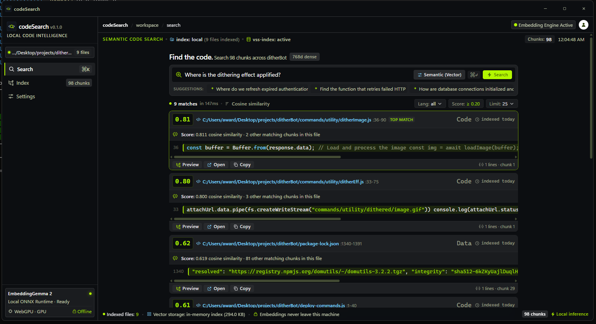
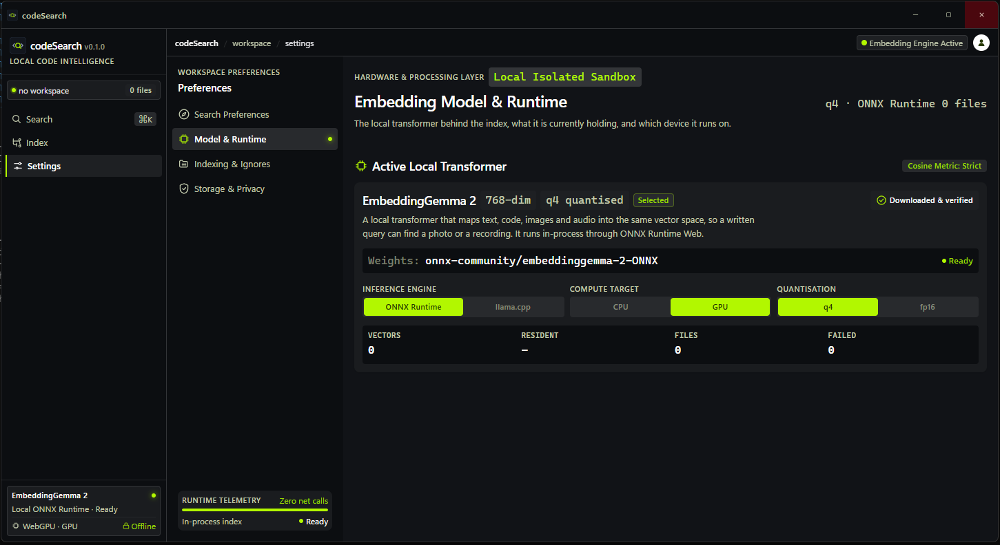

<div align="center">
  
  <h1>codeSearch</h1>
  <p><strong>Local, private semantic search over your files.</strong><br />
  Describe what you're looking for in plain language — find it by meaning, not keywords.<br />
  Nothing is uploaded. The model runs on your machine.</p>
</div>

## Screenshots

### Search



Type what the code *does* ("retry exponential backoff", "auth token expiry") and
results are ranked by semantic similarity, with the matched snippet, similarity
score, and file location on every card. Recent searches and suggested intents
make the empty state useful from the first run.

### Settings



The embedding model and runtime, retrieval tuning (result cap, similarity
cutoff), chunking configuration, and storage/privacy controls — with every
readout measured from the live index rather than hard-coded.

## Features

- **Index a folder, or add files by hand.** The OS picker walks the chosen
  folder; the app never enumerates your machine on its own.
- **Search by meaning.** Queries and file chunks are embedded with
  EmbeddingGemma 2 into a shared 768-dimensional space and ranked by cosine
  similarity.
- **Multimodal in one space.** Text, code, images, audio and video land in the
  same vector space, so a written query can find a photo or a recording.
- **Preview with the match in context.** Open a result to see the real file
  with matching lines highlighted and scrolled into view; media plays inline.
- **Incremental indexing.** Unchanged files are skipped on re-scan, so only
  what's new gets embedded.
- **Tunable retrieval.** Result cap and similarity cutoff live in Settings and
  apply to every search.
- **Custom window frame.** Borderless Tauri window with its own titlebar:
  drag-to-move, minimize, maximize/restore, close, and double-click to toggle.

## How it works

```
Folder ──► Walk (Rust, pruned) ──► Read & normalize ──► Boundary-aware chunks
                                                        ──► Embed (ONNX, local)
                                                        ──► In-memory index
Query ──► Embed ──► Cosine similarity over chunks ──► Ranked files
```

- **Walking & pruning (Rust).** `node_modules`, `.git`, `target`, `dist`,
  `.venv`, caches and OS folders are pruned before the walk reaches them.
  Hidden *directories* (e.g. `.github`) are kept; hidden *files* (e.g. `.env`)
  and files over 10 MB are skipped.
- **Chunking.** Boundary-aware splitting (paragraph → sentence → whitespace,
  ~1,600 chars with 220 chars of whole-line overlap) with 1-based source line
  ranges recorded, so results point at real locations.
- **Embeddings.** [EmbeddingGemma 2](https://huggingface.co/onnx-community/embeddinggemma-2-ONNX)
  via ONNX Runtime Web (WebGPU on GPU, WASM on CPU), q4 quantized, L2-normalized
  so the dot product is cosine similarity.
- **Index.** Held in memory in the app process and released on close — there is
  no server, no database file, and no sync.

## Tech stack

| Layer    | Choice |
| -------- | ------ |
| Desktop  | [Tauri v2](https://tauri.app/) (Rust + webview, borderless window) |
| UI       | React 19, TypeScript, Tailwind CSS v4 |
| ML       | `@huggingface/transformers`, ONNX Runtime Web, EmbeddingGemma 2 |
| Files    | `pdfjs-dist` (PDF), `mammoth` (Word), native media playback |
| Design   | Original UI designed in Google Stitch, implemented as React components |

## Prerequisites

- **Node.js** (LTS) and npm
- **Rust** stable toolchain — only needed to run/build the desktop app
  (`tauri dev` / `tauri build`); the frontend alone runs with plain Vite

## Getting started

```bash
npm install
npm run tauri dev
```

The first run downloads the model weights from the Hugging Face Hub (~470 MB
at q4 for all three encoders; a session only fetches the encoders it needs)
and caches them. Every later session runs fully offline.

Frontend-only development (no window controls — those need the Tauri runtime):

```bash
npm run dev
```

Production build:

```bash
npm run build        # tsc + vite build
npm run tauri build  # app bundle
```

## Usage

1. **Index tab** — pick a project folder (or add files individually, or load
   the built-in sample corpus to try search immediately).
2. **Search tab** — describe what you want; `Ctrl/⌘+K` focuses the field from
   anywhere, `↑/↓` moves through results, `↵` opens the preview, `Esc`
   clears/closes.
3. **Settings tab** — check the model state, tune the result cap and similarity
   cutoff, inspect the workspace, or purge the index and history.

## Project layout

```
src/
  features/
    shell/         App frame: custom titlebar, nav rail, context bar
    search/        Search screen, result cards, code tinting, history
    indexing/     Index screen: folder scan, pipeline, file table
    settings/     Settings screen: model, retrieval, chunking, privacy
    preview/      File preview sheet with match navigation
  components/      Shared UI: icons (offline SVG set), badges, error boundary
  hooks/           React context wiring the module-level services
  lib/
    embeddings/    Model config, worker protocol, client, token budgeting
    indexing/      Bulk pipeline: plan, batch, scatter back to files
    chunking/      Text normalization and boundary-aware chunking
    extractors/    File-kind extension registry
    media/         Video frame extraction
    preview/       Preview store and data loading
    scanning/      Folder scan and bulk-read IPC
    search/        Search service, settings and history stores
  types/           Shared application types
src-tauri/src/
  commands.rs      Validated file reads (text, bulk, media bytes)
  scanner.rs       Parallel folder walk with pruning
scripts/           Smoke and verification scripts (see below)
assets/            Logo and app screenshots used in this README
```

## Checks

```bash
npm run build                     # tsc && vite build
npm run test:rust                 # cargo test
npm run smoke:render              # render the whole app to a string
npm run verify:embeddings         # real model: retrieval quality
npm run verify:multimodal         # real model: image/audio/video in one space
npm run verify:preview            # preview data path and line-number contract
npm run verify:bulk               # scan -> chunk -> batch -> scatter
npm run verify:folder-scan        # end-to-end scan of a real project tree
```

`verify:folder-scan` builds a realistic project tree on disk and runs it
through the actual Rust scanner, so the pruning and classification rules are
exercised against real files rather than a reimplementation.

## Privacy

- File contents, extracted text, embeddings, media and queries stay in the app
  process on your machine. None of it is uploaded.
- The only network access is the first model download from Hugging Face.
- No analytics, no telemetry.

## Contributing

Issues and pull requests are welcome. Please run `npm run build` and
`npm run smoke:render` (plus `npm run test:rust` if you touched `src-tauri`)
before opening a PR.

## License

MIT — see [LICENSE](LICENSE).
